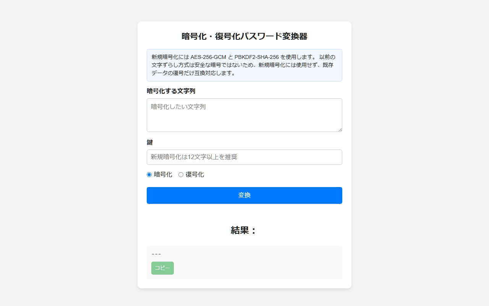

# Caesar Cipher & Authenticated Encryption Web Tool

ブラウザ上で動作するテキスト暗号化・復号Webツールです。従来のシーザー暗号に加え、Web Crypto API（PBKDF2 + AES-GCM）を用いたパスワードベースの認証付き暗号化に対応しています。

- **デモページ**: https://sp9r.github.io/Caesar-cipher/
- 外部通信を行わず、すべての暗号化・復号処理がブラウザ内で完結します（CSP適用済み）。

## 画面イメージ

